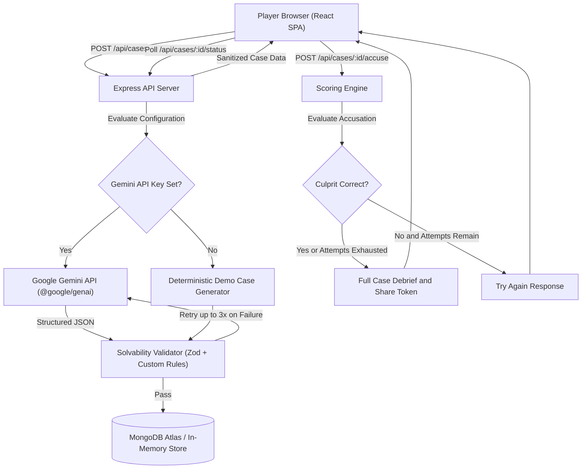

# AI Mystery Room

A full-stack web application that transforms user-submitted story seeds into interactive, solvable detective investigations. An Express backend coordinates mystery generation using Google Gemini, validates the narrative for logical solvability, and serves a React detective-board interface.


---

## Table of Contents

- [Overview](#overview)
- [Motivation and Problem Statement](#motivation-and-problem-statement)
- [Key Features](#key-features)
- [System Architecture and Workflow](#system-architecture-and-workflow)
- [Technologies Used](#technologies-used)
- [Project Structure](#project-structure)
- [Installation and Setup](#installation-and-setup)
- [Dependencies](#dependencies)
- [Configuration and Environment Variables](#configuration-and-environment-variables)
- [How to Run the Project](#how-to-run-the-project)
- [Deployment on Render](#deployment-on-render)
- [Dataset and Case Generation](#dataset-and-case-generation)
- [Model Architecture and Generation Pipeline](#model-architecture-and-generation-pipeline)
- [Evaluation and Scoring System](#evaluation-and-scoring-system)
- [Limitations](#limitations)
- [Future Improvements](#future-improvements)
- [Contributing](#contributing)
- [License](#license)
- [Author](#author)

---

## Overview

AI Mystery Room allows players to submit a brief narrative premise (for example, "A rare orchid went missing from a quiet greenhouse"), select a difficulty tier, and choose an atmospheric tone. The system builds a structured investigation containing suspect profiles, alibis, chat logs, incident reports, photographic evidence, and CCTV logs.

Players review the evidence, log personal notes on an autosaved scratchpad, request optional hints, and submit an accusation with their deduction reasoning. If the player identifies the culprit or exhausts their allowed attempts, the application displays a complete case debrief showing the culprit's motive, method, opportunity, reconstruction timeline, and supporting clues.

The project runs as an npm monorepo with client and server workspaces. In development, it can run completely offline using an in-memory store and a deterministic demo case. In production, it connects to MongoDB Atlas for case persistence and compiles the client into static assets served directly by Express.

---

## Motivation and Problem Statement

Procedural stories generated by large language models often suffer from plot holes, circular evidence, or impossible deductions. A detective game requires strict logical consistency: the culprit must have motive and opportunity, their alibi must collapse under scrutiny, and the player must have enough independent evidence to reach the correct conclusion without guessing.

AI Mystery Room addresses this challenge by placing an automated validation layer between model generation and player presentation. Generated cases must satisfy strict integrity rules before they are marked ready for investigation. If a generated case violates solvability constraints, the system retries generation or reports a validation error instead of presenting broken puzzles to the player.

---

## Key Features

- Dynamic mystery creation: Generates complete fictional cases from short user prompts (10 to 1,000 characters) across three difficulty levels (`easy`, `medium`, `hard`) and four tones (`realistic`, `noir`, `cozy`, `thriller`).
- Solvability verification: Enforces structural checks requiring at least three independent clues, alibi contradictions, and at least two explainable red herrings.
- Multi-channel evidence archive: Generates varied evidence types including messaging threads, official documents, photo records with descriptive alt text, and timestamped CCTV frame sequences.
- Anti-cheat data serialization: Filters out solution objects, culprit IDs, and timeline explanations from client responses until the case status is resolved.
- Interactive detective board: Provides a responsive three-column interface with suspect cards, tabbed evidence browsers, and an autosaved local notebook.
- Progressive hint system: Offers up to three hints per case with proportional score deductions.
- Deductive scoring engine: Computes player scores based on difficulty base points, elapsed time, hints used, accusation attempts, and keyword matching against key clues.
- Dual-mode data layer: Persists cases to MongoDB Atlas with an automatic 7-day TTL index, or runs with an in-memory Map when MongoDB is unavailable.
- Offline demo mode: Provides a built-in deterministic mystery (`The Orchid Heirloom Case`) when Gemini API credentials are not supplied.
- Spoiler-safe case sharing: Generates unique public share tokens once an investigation is resolved.
- Single-origin production setup: Compiles the React client with Vite and serves it through Express, eliminating cross-origin configuration in production deployments.

---

## System Architecture and Workflow



### Request and Data Flow

1. Case creation: The user submits a seed, difficulty, and tone. The API assigns a unique guest session cookie (`guestId`) and creates a case record with status `generating`.
2. Asynchronous generation: If configured, the backend queries Google Gemini using `@google/genai` with a system prompt instructing the model to output structured JSON matching the mystery schema.
3. Logical validation: The generated payload passes through `validateMystery()`. If requirements are met, status updates to `ready`. If validation fails, the server retries generation up to three times before marking the case `failed`.
4. Investigation: The client polls the status endpoint until the case is ready, then loads the public case file. Private solution details remain hidden on the server.
5. Accusation and resolution: The player names a suspect and provides reasoning. The backend checks the submission against the hidden solution, computes the score, and reveals the resolution.

---

## Technologies Used

| Category | Technology | Version | Purpose |
| --- | --- | --- | --- |
| Frontend | React | 18.3.1 | User interface component architecture |
| Frontend | Vite | 6.0.7 | Fast development server and production bundler |
| Frontend | React Router | 7.1.1 | Client-side routing for setup, investigation, and debrief |
| Frontend | Axios | 1.7.9 | HTTP client configured with credentials for API requests |
| Frontend | Lucide React | 0.468.0 | Iconography across evidence cards and controls |
| Frontend | Zustand | 5.0.3 | Client state management utility |
| Styling | CSS3 | Custom | Noir detective design system with responsive layouts |
| Backend | Node.js | >= 20.0.0 | JavaScript runtime environment |
| Backend | Express | 4.21.2 | REST API routing and static production hosting |
| AI Integration | Google GenAI SDK | 1.11.0 | Official SDK for Gemini text generation models |
| Data Validation | Zod | 3.24.1 | Schema validation for user inputs and Gemini responses |
| Database | MongoDB & Mongoose | 8.9.5 | Object document modeling, case persistence, and TTL indexing |
| Security | Helmet | 8.0.0 | Secure HTTP response headers |
| Security | Express Rate Limit | 7.5.0 | Rate limiting (100 requests per 15 minutes per IP on `/api`) |
| Security | Cookie Parser | 1.4.7 | Parsing and setting signed HTTP-only guest session cookies |
| Tooling | Concurrently | 9.1.2 | Running client and server scripts simultaneously in development |

---

## Project Structure

```text
AI_Mystery/
├── client/
│   ├── src/
│   │   ├── App.jsx              # Main React application, routes, and views
│   │   ├── main.jsx             # React DOM root and router initialization
│   │   └── styles.css           # Custom noir stylesheet and responsive rules
│   ├── index.html               # Single-page application entry point
│   ├── package.json             # Client package definition and dependencies
│   └── vite.config.js           # Vite build configuration and local API proxy
├── server/
│   ├── src/
│   │   ├── config/
│   │   │   └── db.js            # MongoDB connection handler and status helpers
│   │   ├── models/
│   │   │   └── CaseRecord.js    # Mongoose schema with 7-day automatic TTL index
│   │   ├── services/
│   │   │   ├── gemini/
│   │   │   │   └── generateMystery.js # Gemini SDK call, retry logic, and Zod parser
│   │   │   ├── cases.js         # Case lifecycle, fallback generator, and store
│   │   │   ├── scoring.js       # Scoring algorithm and penalty calculations
│   │   │   ├── serialization.js # Redaction filter for active case payloads
│   │   │   └── validators.js    # Structural and solvability validation rules
│   │   ├── app.js               # Express application setup, routes, and error handlers
│   │   └── index.js             # Server entry point, database hook, and listener
│   ├── .env.example             # Server environment variables template
│   └── package.json             # Server package definition and dependencies
├── .env.example                 # Root environment variable template
├── .gitignore                   # Git file and folder exclusion rules
├── DECISIONS.md                 # Record of architectural and fallback decisions
├── package.json                 # Monorepo root configuration with npm workspaces
├── package-lock.json            # Complete npm dependency lockfile
├── README.md                    # Project documentation
├── render.yaml                  # Render blueprint configuration for web service
└── SPEC.md                      # Product and technical specifications
```

---

## Installation and Setup

### Prerequisites

- Node.js 20.0.0 or higher
- npm 9.0.0 or higher
- (Optional) A Google AI Studio API key for live Gemini generation
- (Optional) A MongoDB Atlas connection string or local MongoDB instance

### Installation Steps

1. Clone the repository:
   ```bash
   git clone https://github.com/chanu08/AI_Mystery.git
   cd AI_Mystery
   ```

2. Install dependencies for all workspaces:
   ```bash
   npm ci
   ```

3. Configure environment variables:
   Copy `server/.env.example` to `server/.env`:
   ```bash
   cp server/.env.example server/.env
   ```

4. Edit `server/.env` with your preferred settings:
   ```env
   PORT=5000
   CLIENT_URL=http://localhost:5173
   GEMINI_API_KEY=your_gemini_api_key_here
   GEMINI_TEXT_MODEL=gemini-3.6-flash
   MONGODB_URI=your_mongodb_connection_string_here
   ```

   If you leave `GEMINI_API_KEY` blank, the server automatically supplies the built-in demo mystery. If you leave `MONGODB_URI` blank, the server stores cases in memory.

---

## Dependencies

The project uses npm workspaces to isolate backend and frontend dependencies while sharing root-level scripts:

- Root workspace: Orchestrates concurrent execution via `concurrently`.
- Client workspace (`client/package.json`): Contains `react`, `react-dom`, `react-router-dom`, `axios`, `lucide-react`, and `zustand`, built with `vite` and `@vitejs/plugin-react`.
- Server workspace (`server/package.json`): Contains `@google/genai`, `express`, `mongoose`, `zod`, `helmet`, `cors`, `cookie-parser`, `express-rate-limit`, `jsonwebtoken`, and `bcryptjs`.

---

## Configuration and Environment Variables

The application reads configuration values from `server/.env` (and falls back to root `.env` if present).

| Variable | Required | Default Value | Description |
| --- | --- | --- | --- |
| `PORT` | No | `5000` | Port on which the Express server listens. |
| `NODE_ENV` | No | `development` | Set to `production` for production builds and secure cookies. |
| `CLIENT_URL` | No | `http://localhost:5173` | Allowed origin for CORS in development mode. |
| `MONGODB_URI` | In production | Empty string | MongoDB connection string. Required for persistent deployments. |
| `GEMINI_API_KEY` | For AI generation | Empty string | Google AI Studio API key. If omitted, demo mystery is used. |
| `GEMINI_TEXT_MODEL` | For AI generation | `gemini-3.6-flash` | Gemini model name used for case creation. |
| `GEMINI_IMAGE_MODEL` | No | Empty string | Reserved for future image generation integration. |
| `MAX_ATTEMPTS` | No | `2` | Maximum accusation attempts allowed per investigation. |
| `JWT_SECRET` | No | `change-me` | Reserved for future registered user authentication. |
| `GUEST_TOKEN_SECRET` | No | `change-me` | Reserved for future cryptographic guest token signing. |

---

## How to Run the Project

### Development Mode

Run the client and server concurrently with one command from the repository root:

```bash
npm run dev
```

- The Express backend starts on `http://localhost:5000` with file watching via `node --watch`.
- The Vite frontend starts on `http://localhost:5173` with hot module replacement and an automated proxy forwarding `/api` calls to port 5000.
- Open your browser to `http://localhost:5173`.

### Production Build

To test the unified production build locally:

1. Build the client assets:
   ```bash
   npm run build
   ```
   This generates the production bundle in `client/dist`.

2. Start the Express server in production mode:
   ```bash
   NODE_ENV=production npm start
   ```
   Express serves both the `/api` endpoints and the compiled client from `client/dist` on port 5000.

---

## Deployment on Render

This repository includes a `render.yaml` blueprint configured for Render's free web service tier. In production, a single service hosts both the client and API.

### 1. Set Up MongoDB Atlas

1. Create a free cluster on MongoDB Atlas.
2. Under Database Access, create a database user with read and write permissions.
3. Under Network Access, allow access from anywhere (`0.0.0.0/0`) or add Render's outbound IP addresses.
4. Copy the connection string (format: `mongodb+srv://<user>:<password>@cluster.mongodb.net/ai_mystery_room?retryWrites=true&w=majority`).

### 2. Deploy via Render Blueprint

1. Push your repository to GitHub.
2. In the Render Dashboard, select **New → Blueprint**.
3. Select your repository. Render reads `render.yaml` and configures the `ai-mystery-room` web service.
4. When prompted, fill in the secret environment variables:
   - `GEMINI_API_KEY`: Your key from Google AI Studio.
   - `MONGODB_URI`: Your MongoDB Atlas connection string.
5. Deploy the service.

### 3. Verify Health Check

Once the build finishes, verify the deployment by checking the health endpoint:

```text
GET https://<your-service-name>.onrender.com/api/health
```

Expected response:
```json
{
  "status": "ok",
  "service": "ai-mystery-room",
  "database": "connected",
  "databaseErrorCode": null
}
```

---

## Dataset and Case Generation

Cases in AI Mystery Room are generated procedurally rather than loaded from a static database:

- Fictional procedural generation: Gemini synthesizes suspects, alibis, motives, and evidence items tailored to the player's seed prompt and selected tone. Prompts instruct the model to produce PG-13 non-graphic fictional scenarios, avoiding real persons or real crimes.
- Built-in fallback case: When running without an API key, the system provides a deterministic sample case, "The Orchid Heirloom Case", set in Orchid Hall, Pune. It includes four suspects (event coordinator Mira Sen, photographer Arjun Mehta, family friend Leena Rao, and venue manager Dev Khanna), five evidence items, and a verified solution.

---

## Model Architecture and Generation Pipeline

When a player initiates a case, the backend issues a prompt to the Google Gemini API using `@google/genai` with structured JSON output enforcement (`responseMimeType: 'application/json'`). The resulting payload is validated by Zod and evaluated against logical solvability rules in `server/src/services/validators.js`.

### Solvability Constraints

Every case must satisfy these checks:

1. Culprit reference: The designated culprit ID (`culpritSuspectId`) must correspond to a listed suspect.
2. Independent clues: At least three key clues must exist, and each clue must reference a distinct evidence ID.
3. Red herrings: At least two explainable red herrings must be present, each pointing to a non-culprit suspect and a valid evidence ID.
4. Suspect count: Between 3 and 6 suspects must be generated, each containing valid ID, age, occupation, relationship, and alibi fields.
5. Evidence volume: The case must contain at least 7 evidence items in total.
6. Evidence diversity: The case must contain at least one item from each evidence type: `chat`, `image`, `cctv`, and `document`.
7. Referential integrity: Every evidence reference in clues, red herrings, and the reconstruction timeline must match an existing evidence item in the case.

If any check fails, the generator retries with a lower temperature (0.6) and passes the specific validation error message back into the prompt so the model can correct its output.

---

## Evaluation and Scoring System

Case scores are calculated dynamically by `scoreCase()` in `server/src/services/scoring.js`:

```text
Final Score = Base Score - Hint Penalties - Time Penalty - Attempt Penalty + Reasoning Bonus
```

The components operate as follows:

- Base points: `1,000` (Easy), `1,500` (Medium), or `2,000` (Hard).
- Hint deductions: `-150` points per hint requested (maximum of 3 hints).
- Attempt penalty: `-25%` of the base score if the mystery is solved on the second attempt.
- Time deduction: Investigations exceeding 5 minutes lose points proportionally based on elapsed time, capped at a maximum deduction of 40% of the base score.
- Reasoning bonus: `+10%` of the base score if the player's optional deduction text contains key terms matching at least two official key clue explanations.
- Score floor: A solved case earns at least `100` points regardless of accumulated penalties.

---

## Limitations

- Image assets: Image and CCTV evidence cards currently display descriptive text, timecodes, camera locations, and alt text rather than generated bitmap images.
- Guest sessions: User progress is scoped to a browser cookie (`guestId`). Clearing browser storage or switching browsers starts a fresh guest session.
- Generation latency: Gemini API text generation usually takes between 15 and 40 seconds depending on server load and model response time.

---

## Future Improvements

These items are documented in `SPEC.md` as targets for future releases:

- User authentication: Account registration and login using JWT and bcrypt password hashing to retain case histories across devices.
- Image generation models: Integrating Gemini image models to generate visual character portraits and CCTV image frames.
- Background task queue: Adopting Redis and BullMQ for worker-based generation pipelines when scaling to higher concurrent traffic.
- Cloud media storage: Integrating S3-compatible object storage or Cloudinary for uploaded and generated binary media.
- Automated test suite: Adding Vitest component tests for the React frontend and Jest/Supertest integration suites for API endpoints.

---

## Contributing

Contributions to improve case validation, expand evidence types, or refine the user interface are welcome.

1. Fork the repository.
2. Create a feature branch:
   ```bash
   git checkout -b feature/your-feature-name
   ```
3. Commit your changes with clear, descriptive commit messages:
   ```bash
   git commit -m "Add validation rule for suspect alibi overlap"
   ```
4. Push your branch to your fork:
   ```bash
   git push origin feature/your-feature-name
   ```
5. Open a Pull Request detailing the problem solved and the tests performed.

---

## License

This project is licensed under the MIT License.

---

## Author

Created and maintained by **Chanu** ([@chanu08](https://github.com/chanu08)).

If you find this project interesting or educational, feel free to star the repository.
